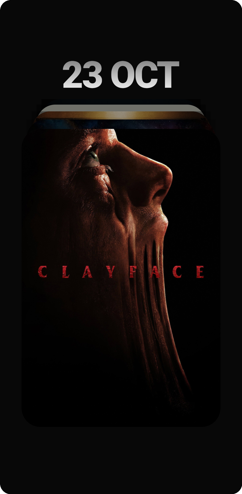
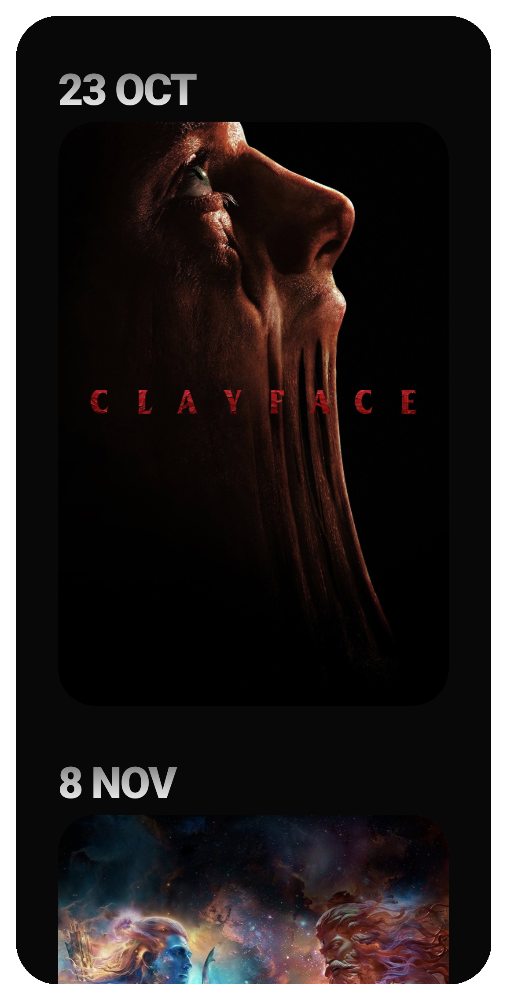
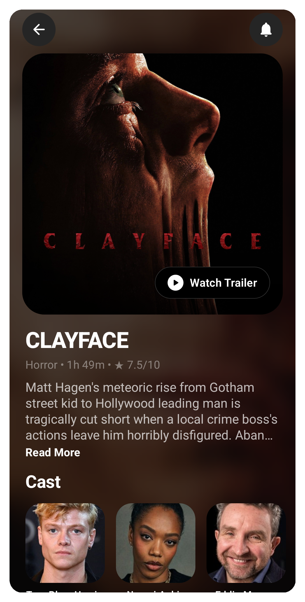
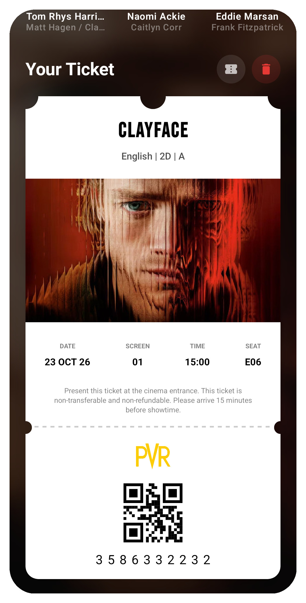
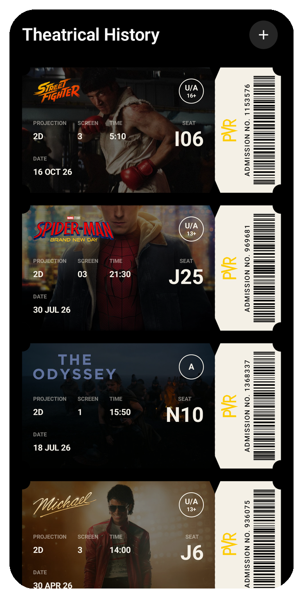
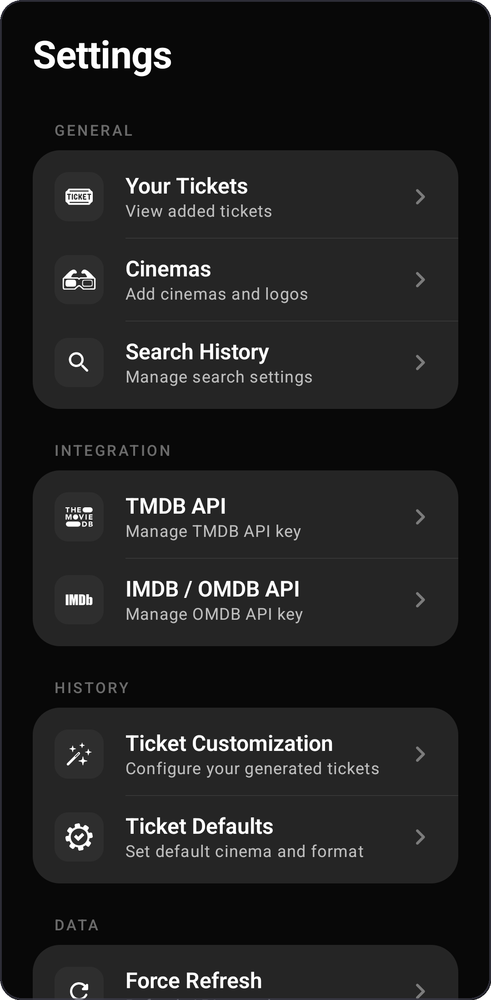

<p align="center">
  <picture>
    <source media="(prefers-color-scheme: dark)" srcset="Screenshots/banner_dark.png">
    <source media="(prefers-color-scheme: light)" srcset="Screenshots/banner_light.png">
    
  </picture>
</p>

<p align="center">
  <a href="https://github.com/AdityasahuX07/Premiere"></a>
  <a href="https://kotlinlang.org"></a>
  <a href="https://developer.android.com/jetpack/compose"></a>
  <a href="https://m3.material.io/"></a>
  <a href="https://buymeacoffee.com/adityasahu"></a>
</p>

<p align="center">
  <b>A modern Android application for discovering upcoming theatrical movie releases, managing tickets, setting release notifications, and tracking theatrical movies watched history.</b>
</p>

---

## 📸 Screenshots

<p align="center">
  
  
  
</p>

<p align="center">
  
  
  
</p>

---

## ✨ Features

- 🎟️ **Upcoming Releases & Discovery**: Browse upcoming movies and release dates powered by TMDB.
- 🍿 **Ticket & Watchlist Tracking**: Save upcoming movies to your watchlist and track ticket bookings.
- 🔔 **Smart Reminders**: Automated notifications for movie release dates and booked shows using WorkManager and exact alarms.
- 🎞️ **Detailed Movie Insights**: Ratings, cast, synopsis, runtime, certifications, and trailers (TMDB & OMDB integration).
- 💾 **Local Offline Storage**: Room database for persistent movie and ticket storage with backup & export capabilities.
- 🎨 **Modern UI**: Built 100% with Jetpack Compose, Material 3, fluid animations, and custom typography.

## 🛠️ Tech Stack & Architecture

- **Language**: [Kotlin](https://kotlinlang.org/)
- **UI Framework**: [Jetpack Compose](https://developer.android.com/jetpack/compose) + [Material 3](https://m3.material.io/)
- **Architecture**: MVVM with Clean Architecture principles
- **Dependency Injection**: [Hilt](https://dagger.dev/hilt/)
- **Database**: [Room](https://developer.android.com/training/data-storage/room)
- **Networking**: [Retrofit](https://square.github.io/retrofit/) + [Moshi](https://github.com/square/moshi) + OkHttp
- **Image Loading**: [Coil Compose](https://coil-kt.github.io/coil/)
- **Background Work**: [WorkManager](https://developer.android.com/topic/libraries/architecture/workmanager)
- **Preferences**: [Jetpack DataStore](https://developer.android.com/topic/libraries/architecture/datastore)

## 🚀 Getting Started

### Prerequisites
- Android Studio Ladybug / Meerkat or later
- JDK 17
- Android SDK (API 36 compile, Min SDK 26)

### Setup
1. Clone the repository:
   ```bash
   git clone https://github.com/AdityasahuX07/Premiere.git
   ```
2. Open the project in Android Studio.
3. Sync Gradle and run the application on an emulator or physical device.
4. (Optional) Add your TMDB and OMDB API keys via the in-app Settings panel to enable real-time searches and detailed metadata.

## ☕ Support

If you like this project and find it helpful, consider supporting its development:

[](https://buymeacoffee.com/adityasahu)
